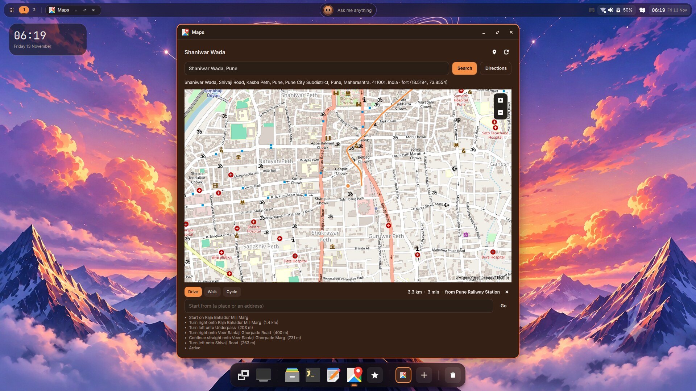

# The ShaniOS desktop — features

**A desktop where everything is a click or a glance away.** Sign in by looking at
the camera. Find anything by typing a few letters. Change any setting by picking
from choices — never by typing values you'd have to know. And when you're not
using it, it costs almost nothing.

Built on the [niri](https://github.com/YaLTeR/niri) scrolling compositor and
[Quickshell](https://quickshell.org). Every feature below is in the shell today.
Most are driven by the test suite in a real nested session (over 700 checks);
what needs real hardware, what has no check yet, and what has only been proven
in that nested session - not yet on an installed image - is listed in
[docs/GAPS.md](docs/GAPS.md).

---

## Sign in without typing

- **Face sign-in** — look at an infrared camera, like Windows Hello. Works on the
  sign-in screen and the lock screen. Set up in five guided looks.
- **Fingerprint** — touch the reader to unlock; enrol fingers in Settings.
- **Security keys** (YubiKey and other FIDO keys) — register one, touch it to unlock
  or sign in.
- **Your password always works too**, and is still asked for changes to the system.
  The **first sign-in after a restart is the password** — the only thing that unlocks
  your saved passwords (the keyring) — and the screen says so; after that a look, a
  finger or a key is enough.
- **Pick who's signing in** — your picture and name are already chosen; no user
  name to type. "Someone else" is one click away.
- **An on-screen keyboard at sign-in, setup and lock**, opening by itself on
  touchscreens. Plus a **Caps Lock warning** and **Show password**.
- **A lock screen you can use** — notifications, now playing, a camera button,
  restart and power off (hold for two seconds; press-twice also works).
- **Settings › About** shows a read-only health score and a problem report you
  can read and edit before saving — nothing is sent. **System Monitor** draws
  CPU, memory and network history from the samples it already takes.

## A desktop that stays out of your way

- **Bar, dock and Island** — workspaces, the focused window with its own minimise,
  maximise and close, now playing, status at a glance. The bar and dock **step
  aside for your windows** and come back at the edge.
- **The Island** — the middle of the bar shows what's happening: a recording, a
  call, a timer, a print job — click to act on it.
- **Overview** of every window, an **Alt+Tab** switcher, a **pie menu** at the
  pointer, **hot corners**, **desktop layouts** to try on with one click.
- **The app's own menus, from the bar** — click the focused window's title: its
  File, Edit, View … with their shortcuts and submenus, read from the app's
  accessibility tree (niri has no app-menu protocol). GTK 3, Qt and XWayland apps
  show theirs; apps that show no menu bar (GTK 4's popover menus, Firefox,
  Electron) offer their desktop actions, like "New Window", instead.
- **Name your workspaces** from the bar. **Rounded screen corners.**
- **A drop shelf** — drop files on the dock to keep them for later, then drag them
  into any app.
- **Trash on the dock** — drop to bin, empty with two clicks.
- **A desktop right-click menu** — wallpaper, widgets, icons, displays, terminal.
- **Windows that open beautifully** — pick how they open and close: *Glide*
  (rises into place as it fades in), *Pop* (springs open with a little bounce),
  *Dissolve* (gathers in grains with your accent colour along the edge) or
  niri's plain fade; how fast; a soft or deep shadow; square to round corners;
  and how strong the frosted glass is. Settings › Windows › Look and motion.
- **A terminal that opens instantly and knows the desktop** — Foot as a server
  (a window in about 90 ms), in the desktop's colours, switching light and dark
  with it; Ctrl+Shift+A asks Chronoa what the last command's output means.
  Mod+Return, the shell and every app open the terminal chosen in Settings.
- **Per-app window rules** — choose how each app opens: floating or tiled, which
  workspace, how wide.
- **A drop-down terminal** (or any app) one key away, over whatever is open.
- **Your apps reopen** at your next sign-in, the way you left them.
- **Desktop widgets** — clock, calendar, weather, now playing — placed where you like.

## Find anything

- **One launcher for everything** — apps, open windows, files (and words inside
  them), actions like "dark style" or "lock", a **calculator** with unit
  conversion, **emoji**, **clipboard history**, web search.
- **Quick Look** — press Space on a file in Files (or Ctrl+Y on one in the
  launcher, or `shani quick-look PATH`) to see it without opening an app: a
  picture, a video or a song playing, a PDF's first page, code in colour, what
  is inside an archive or folder. Left and Right walk the files beside it; Enter
  opens it. Files now moves with the arrow keys too.
- **A file manager of your own** — the **Files** surface: the places on the left
  (Home, Documents, Downloads, Pictures, Videos, the drives you plugged in), the
  folder on screen as a grid of tiles or a list of rows, a search box, and a
  preview of what you chose. Click to choose, Ctrl-click for more, Shift-click
  for a range, Enter to open, F2 to rename, Delete to move to the **trash**
  (the desktop trash, so it can be put back). The folder is **watched**: a file
  made or removed elsewhere shows up at once.
- **Copy, cut and paste files** (Ctrl+C / X / V, or the right-click menu) — with
  other apps too: files copied in Files paste in GNOME Files and GTK apps, and the
  other way round. Nothing is ever written over: a name that is taken becomes
  "name (2)". **Undo** (Ctrl+Z) puts back a paste, a move, a rename, a batch
  rename or a trip to the trash.
- **The trash** says where each file came from: **put back** returns it there
  (beside it, if something new took the name), **delete for good** and **empty
  the trash** ask twice.
- **Search through the folders inside too**, **Properties** (Alt+Enter: size
  counted through folders, dates, owner, permissions), **rename several at once**
  ("Holiday #" makes Holiday 1, Holiday 2 … each keeping its extension, with a
  preview first) and **bookmarks** in the sidebar - GTK's own, so GTK apps'
  sidebars have them too.
- **Copies the way TeraCopy does them** — speed and time left, **Pause** and Resume,
  **Stop** (only the half-written one goes); **verify** (every copy read back and
  checked, and a move removes a source only once its copy is proven); a name already
  there is asked about **once per copy** (keep both, skip, replace the older ones,
  replace where different, replace all - the replaced ones go to the trash); a
  file that cannot be read is passed over, the rest still copied, and **Retry**
  tries just those; copies wait in a **queue**; **then sleep or shut down** when all
  is done; a **copy history**; **Copy to… / Move to…** with the folders used lately;
  **checksums** made (.sha256) and tested. Browsing carries on meanwhile. **Drag and drop** — files between folders, panes, tabs and the sidebar,
  and to or from other apps: a drop moves on the same drive and copies from another
  (Ctrl copies), with Undo.
- **Phones, drives and servers in the sidebar** — a phone, an iPhone, a camera or a
  USB drive is listed the moment it is there and opens with a click (mounted first);
  **eject** beside it; the computer's other drives below; an **encrypted drive** asks
  for its password. **Connect to server…** (smb, sftp, ftp, WebDAV, NFS, and
  **ssh:// through sshfs** for real paths) lists the servers **this network
  announces**, so a click connects; it asks for a login only when the server does,
  and remembers the servers used. FUSE mounts you made yourself (sshfs, rclone…)
  show there too, with Unmount.
- **Disk images and USB drives** — an ISO or squashfs **opens as a drive** (read-only);
  **Write to a USB drive** puts an .iso or .img (packed .xz/.gz/.zst too) on a stick,
  with progress and Stop; **Format a USB drive** as exFAT, FAT32, NTFS, ext4, Btrfs,
  F2FS, XFS or UDF, optionally **locked with a password**; **back a drive up** into an
  image file; **change a locked drive's password**; its health in Cassini. Only removable drives are
  offered, and the drive's name is typed before anything is erased.
- **Cloud drives** — Google Drive, OneDrive, Dropbox, Box, pCloud, Yandex Disk or a
  Nextcloud, added with the provider's own sign-in and opened from the sidebar like a
  drive (rclone). **All pictures, music, videos, documents and archives** — every one
  in your folders, wherever it is. **Open from your phone** — a folder opened to the
  phones on your Wi-Fi through their browser, behind a QR code and a link nobody can
  guess, read-only unless you let them add files; it closes by itself after an hour
  unused.
- **Locked with a password** — a PDF gets a PDF password (every reader asks for it),
  any other file or folder is sealed (gpg), and **encrypted folders** (gocryptfs) open
  with their password and lock again when closed; the Document Viewer asks for a
  locked PDF's password.
- **Compare** two files side by side, line by line, with next/previous change, and
  **merge**: a change copied to the other side, that side saved (its old version to
  the trash); or two folders by what is only in one and what differs. **Share on the network** — a
  folder from its right-click menu (Samba).
- **Thumbnails** for videos, PDFs and office files, from the desktop's thumbnail cache
  (the one GTK apps share). **Search inside files** — the search box finds files by
  what they say too. **Tabs** (Ctrl+T, Ctrl+W, Ctrl+Tab), **Starred**, **type to find**,
  **zoom** (Ctrl+plus / minus / 0), **turn the selection over** (Ctrl+Shift+I), free
  space in the status line.
- **Redo** (Ctrl+Shift+Z) after Undo; **Shift+Delete** deletes for good after asking
  (only those leave the trash, the rest of it stays); **Nautilus scripts** in
  ~/.local/share/nautilus/scripts appear in the menu and run as Nautilus runs them.
- **A right-click menu everywhere** — on a file, and on the folder itself: new folder,
  **new document** from ~/Templates, paste, **open in terminal**, select all. **Set as
  wallpaper** on a picture; **Properties** changes who else can open a file and whether
  it **runs as a program**, with Undo.
- **Disk Usage** shows what fills the disk as a map, the **biggest files**, and
  **duplicates** (byte for byte), marking every copy but the oldest in one click -
  nothing goes until you review it, and then to the trash.
- **Archives opens every archive** libarchive reads, a lone `.gz`, `.xz` or `.zst` file
  too; Files, Archives and Disk Usage are the default apps for folders and archives.
- **Choose a file in the shell, not in a portal** — the chooser is the shell's
  own: no waiting for the desktop portal, no another app's window.
- **Picks go where you were** — choose an emoji or a clipboard entry and it's typed
  or pasted into the window you came from.
- **Apps' own answers** — GNOME Calculator, Files, Characters and more add their
  results.
- **Lens** — select part of the screen to read its text, scan a QR code, copy,
  search, translate, or ask the assistant about it.
- **Smart suggestions when you copy** — a link to open, an address to email, a
  number to call, a foreign script **translated on your computer**, an error
  explained.

## Apps of its own

- **Apps of its own, each a window** — Files, Text Editor, Media Player, Image
  Viewer, Document Viewer, Photos, Archive Manager, Calculator, Calendar, Tasks,
  Clocks, Weather, Notes, Translate, Camera, Voice Recorder, Characters, Fonts,
  Maps, Disk Usage, Document Scanner, System Monitor, Logs, Password Generator,
  Authenticator, Nearby Share, Converter, PDF Signer, Video Trimmer, Kundali and
  Settings (screen time, storage and colours from a picture live there, as on
  other desktops); and the tools
  Screenshot, Screen Recorder, Color Picker, Screen Ruler, Lens, Magnifier, Live
  Captions and Tour. They tile and float like any window, are in Alt+Tab, can
  be pinned to the dock, and open from a terminal with `shani app <name>`.
  How the set compares with GNOME, KDE, Deepin, Kylin, Cinnamon, macOS,
  Windows and Android: `docs/ECOSYSTEM.md`.
- **Notes you can tick and paste into** — a task's box flips where you click it,
  and an image on the clipboard becomes a file beside the notes, pointed at by
  the note. **The Converter** takes a trim (from/to), a volume, fades, a title
  and an artist, beside the format and the quality.
- **The launcher's escapes** — *Close frozen window* when the polite close is
  ignored, and *Cast this window / this screen / stop casting* for the phone
  (niri's dynamic cast target, so the phone's picture changes without the
  portal asking again).
- **One place for each thing** — the sidebar's weather opens Weather, its
  alarms Clocks, a running timer opens Clocks' timer, screen time the Screen
  Time app; the Media Player is in "now playing", on the lock screen and on the
  media keys like any other player.
- **They open your files** — double-click a video, a song, a picture, a PDF, a
  text file or a zip and the shell's own app opens it.
- **A media player** — play, pause, seek, the next episode or track from the
  same folder, speed, repeat, shuffle, full screen.
  It picks up where you left a long video or song ("Resumed at 1:03 · Start
  over"), offers the sound tracks and subtitles a file has, shows a .srt or
  .vtt lying beside the video, reads a song's own title, artist and cover, and
  shrinks to a mini player that floats on every workspace (I).
- **A text editor that does not lose work** — tabs, find and replace, syntax
  colours, line numbers; close it mid-sentence and the text is there when you
  come back. Saving keeps the file's permissions and line endings.
- **Document Viewer** — PDFs, and e-books (EPUB, FB2, MOBI), comics (CBZ, CBR,
  CB7), XPS and DjVu, each searchable like a PDF; a PDF's form can be filled in
  and a filled copy saved beside it; PostScript and EPS too; **night mode**, **read as
  text** (select and copy), copy a page's text, **document properties**.
- **Image Viewer** — every common format (and anything else ImageMagick reads);
  **animated GIFs and WebPs play**; set as wallpaper; crop (free or to a shape), turn,
  flip, **resize**, and **mark it up** - pen, highlighter, line, arrow, box, text, and
  **blur** to hide a face or a number; saved as a copy beside it or in
  place, the original kept in the trash. Fonts opens a font file to preview and
  install it (with its version, maker and languages); Maps shows a place's hours,
  phone and website, keeps saved places and **shares a place** (link and QR code); the
  Media Player **saves the frame on screen** as a picture, plays **internet radio**
  (search, popular, near you, by genre, favourites - radio-browser.info's stations) and has a
  **Live TV** page (the Hypnotix idea): load your own M3U URL or file, browse channels by group,
  search them and watch a channel in the player. It opens with free public broadcaster streams
  (Indian and world news), and Radio opens with dozens of free stations; the full community
  Free-TV playlist is one click away. Nothing is sent anywhere and no streams are hosted here.
- **Software** — Flathub's apps by name or kind, each with its page (what it does, who
  makes it, its licence, a screenshot), installed, updated and removed with progress;
  a website's Install link (.flatpakref) opens in it; what removed apps left behind
  in your home folder; **AppImages** added to the launcher. **Passwords and Keys** —
  the passwords apps saved in the keyring, found, shown on request, copied (the
  clipboard forgets them in 45 s), changed, added and deleted; your **GPG keys** made,
  imported, exported and deleted. **Containers** — Distrobox toolboxes (a whole
  Ubuntu, Fedora, Arch or Debian sharing your home folder) made from a chip, opened
  in your terminal, their apps put in your menu, updated and removed; your rootless
  Podman containers started, stopped, restarted, their logs read; unused images
  pruned. Docker tools and IDE dev containers find Podman's Docker-compatible socket
  on their own. **App permissions** - everything Flatseal shows
  for a Flatpak (sharing, sockets, devices, features, folders, environment, D-Bus
  names) and what the portals answer it (notifications, background, camera,
  location), each change yours and undone by Reset.
- **Calendar accounts** — a CalDAV server (Nextcloud, Fastmail, iCloud, mailbox.org,
  any other) added with its password; its calendars come by themselves; an .ics
  invitation opened is added to your calendar. **Open and Save dialogs** of sandboxed
  apps are the shell's own file picker.
- **Tidy and name** — Files' Tidy sorts a folder (Downloads, say) into folders by
  kind, shown first and undone in one click; "Suggest a name" asks Chronoa for a
  name from the file's own words (a scan's text, a PDF's first pages).
- **Search by meaning** — the launcher also asks Chronoa's index of Documents,
  Downloads and Desktop, so "the electricity bill from March" finds the scan
  that says so.
- **Maps** — a map that fills the window: drag to move, wheel or +/- to zoom,
  search a place, and directions there by car, on foot or by bike
  (OpenStreetMap's tiles, Nominatim and OSRM), drawn on the map with the
  distance, the time and each turn.
- **Archive Manager** — see what is inside a zip, tar, 7z or ISO; extract all of it
  into a new folder, or one item beside the archive (never over a file);
  password-protected archives ask for their password instead of hanging; and
  Compress in Files' right-click menu makes a zip, tar.gz, tar.xz or 7z.
- **Clocks** — world time, alarms, a stopwatch and a timer in one place.
- **Tasks** — to-dos with a due day picked, not typed; the same lists as
  Thunderbird and Chronoa.
- **Authenticator** — two-factor codes kept on this computer, and the ones on a
  connected **YubiKey** too (yubikey-manager): a code that wants a touch says so,
  and is copied when the key is touched.
- **Photos** — every picture in Pictures by month; **Translate** — on this
  computer, nothing sent anywhere.
- **Nothing extra at sign-in** — an app is read the first time it is opened.

## Quick Settings and notifications

- **Quick Settings** — volume, brightness and ~40 tiles (Wi-Fi, Bluetooth, VPN,
  hotspot, Do Not Disturb, night light, dark style, screen record, screenshot,
  colour picker, keyboard light, compass…). Each tile **appears only where it can
  work**; rearrange them in place.
- **Do Not Disturb for an hour, until your meeting ends, or until tomorrow** — and
  **quiet hours** every night.
- **Notification rules** — no pop-ups from an app, or drop it altogether, from the
  notification itself or Settings.
- **Swipe a notification away**, **snooze it**, reply inline; **clicking it brings
  its app forward**. Unread notifications **survive a restart**.
- **A sound for each notification**, **flash alerts** for the hard of hearing.
- **Quiet by itself while you present or play** — fullscreen holds notifications
  back, and a game also gets the performance power profile.

## Your day, organised

- **Your calendar in the sidebar** with a **heads-up ten minutes before** each
  meeting — from the calendars you already use.
- **Focus modes** (Work, Sleep, Personal) that hold back everything but the apps you
  allow — by hand or on a schedule.
- **A focus timer** (25 minutes on, then a nudge to rest).
- **Screen time** — how long each app had your attention, today and this week, with
  an optional daily reminder.
- **Quick notes** in the sidebar, saved as you type to a plain Markdown file.
- **Weather and world clocks** at a glance.

## Automate the routine

- **"When this, do that" automations** — on a Wi-Fi network, when headphones plug in,
  at a time of day: turn on Do Not Disturb, change the volume, run a command.
- **Hooks** — run your own command when the wallpaper or dark style changes, the
  screen locks or unlocks, or the desktop starts.

## Type however suits you

- **On-screen keyboard** in English, **Marathi** with smart matras, and **any of
  598 keyboard layouts** — including 45 Indian ones.
- **A globe key** to switch languages, the way phone keyboards do.
- **Handwriting** — write on ruled lines with a pen, finger or mouse; scribble over
  a word to rub it out; it's read **on your computer** (English, Hindi, Marathi)
  and typed where you were.
- **Sticky Ctrl and Alt** — tap once for the next key, twice to hold.
- **Voice typing** into any app.
- **Input methods** (fcitx5) with English and Hindi phonetic ready to go.

## Accessible by default

- **Screen reader** support throughout — every control has a name, verified with
  real accessibility tools. **Super + Alt + S** starts it from the very first
  screen (first setup and the sign-in screen), the same shortcut GNOME and
  Plasma use, so it can be found without seeing the screen.
- **Larger text, high contrast, reduce motion, mono audio, magnifier.**
- **Live captions** and **read aloud** for any text.
- **A floating assist button** (AssistiveTouch) for touch and pointer users.
- **The whole desktop by keyboard or game controller** — every button, tile, list
  and menu is reachable, with a clear focus ring. A controller drives the desktop
  (A selects, B goes back, Start opens Quick Settings) and steps aside for games.
  The right stick moves a pointer and the triggers click, for what arrows cannot
  reach (a web page, a canvas); with LB held it scrolls. Guide opens the assistant.
  A text field reached with the controller brings up the screen keyboard, which it
  then types on: the d-pad moves a highlighted key, A types it, X deletes, Y is a
  space, Start is Enter, B hides it.
  LB / RB jump between sections, in Quick Settings and in every app of the shell
  (Quick Settings' notifications are one press away); X opens the menu of what is
  focused, or the window's own. Every app is checked for anything only a click
  reaches (dev/shell-parts/pad-reach.sh).
- **A TV remote drives it, like an Android TV** - arrows, OK and Back for everything;
  Home opens the launcher, Menu the window menu, Back goes one level back (in an app,
  its own back). OK on an empty field - or Up to the launcher's search bar - brings a
  keyboard you type with the arrows and OK; Done hands the text to the field.
- **Never locked out without a keyboard** — the lock screen, sign-in, setup and
  admin prompts each have an on-screen keyboard, which opens by itself when no
  keyboard is connected. Hide it to see the whole screen; a small button brings it back.
- **Every keyboard and laptop key works** — screen and keyboard brightness,
  touchpad on/off, airplane mode, display, calculator, search, mail, browser,
  files, settings, lock.

## Screen, camera and media

- **Screenshots** — region, window or screen; on a 3- or 10-second timer; offered
  for annotation right after.
- **Screen recording** — the screen or a region, with **computer sound and your
  microphone on two separate tracks**; make a GIF or a smaller copy in one click.
- **One media card for every player** — choose which to follow when several play;
  tinted from the album art; **synced lyrics** if you want them.
- **Camera** — photos and video, and a **privacy light** whenever anything uses the
  camera, microphone or screen.
- **Screen ruler, colour picker, QR codes** from the clipboard, **file actions**
  (convert a picture, shrink a file to a form's size limit, read the text in it).
- **Share sheet** for any file — to your phone, a Bluetooth device, nearby devices
  with LocalSend, a folder opened to this network as a QR link, email, or the clipboard.
  The QR link's Stop control lives in Files; sharing a folder asks for it explicitly.
- **Cast your screen** to a TV or Chromecast.
- **Call recording** for any call app, mixing your microphone and the other side —
  with a reminder to tell them.
- **Sound effects** — an equaliser with presets, bass boost, **headphone correction**
  (AutoEq), and per-app volume. Small system sounds for volume, screenshots, the
  charger and drives.
- **A clock screensaver** and a **charging screen** you can glance at across the room.

## Devices and your phone

- **Bluetooth** pairing with the code shown big and clear; a **low battery warning**
  for headphones, mice and watches right in the bar.
- **Drives** — mount, eject, and unlock encrypted ones from Quick Settings.
- **Printers** added automatically; print jobs shown as they run. **Add a printer**
  lists the ones the network announces, or takes an address, and sets it up without
  a driver to pick (IPP Everywhere); your **paper, two-sided and colour** defaults per
  printer; **share a printer** on the network.
- **Your phone (Shani Link)** — calls on your phone, your landline or the laptop's
  own modem; texts; **one address book**; one call history; a dial pad that finds
  contacts as you type; phone links anywhere open the dial pad; use the phone's
  internet over Bluetooth or over a USB cable. Watches and fitness bands too.
  **This screen on your phone**, over a cable or Wi-Fi, and with **touch and
  type** turned on, fingers, a stylus and the phone's keyboard drive the desktop
  through virtual devices; **sound on** plays the desktop's audio on the phone,
  and over a cable the phone's microphone and camera become the computer's
  (the camera for apps that ask PipeWire).
  With "Share the clipboard with your phone" on, copy on one and paste on the
  other; the clipboard history says what came from the phone, and nothing a
  password manager marks secret is sent.
- **Calls ring once**, on the Island, wherever they come from.
- **Your phone's screen in a window** (Android), driven with your mouse and keyboard.
- **Dynamic lock** — the screen locks itself when your phone walks out of range.
- **Send and receive files over Bluetooth**, each asked first.
- **Share your Wi-Fi** as a QR code a phone's camera joins from.
- **Run an app on the faster graphics card** on laptops with two.
- **Plug something in and it says hello** — a monitor asks extend, mirror, only this
  screen or **presenting** (Do Not Disturb and no sleep until it's unplugged); a camera
  offers to import photos; a phone opens its files; a drawing tablet asks which screen;
  a controller shows its battery; a security key offers sign-in; a scanner offers to
  scan; MIDI, capture cards, serial boards, card readers, braille displays and eGPUs
  are named, each with one next step.
- **Gaming mice** — DPI, polling rate and buttons, picked from the mouse's own options.
- **Game controllers** — battery and a live button test. With InputPlumber
  (shani-peripherals), a handheld's built-in controls - or every controller -
  play as the kind a game expects (Xbox, DualSense, Steam Deck), picked in
  Settings; and the **guide button opens Quick Settings over a game**: the
  controller is lent to the desktop, the game sees no press until you close it.
- **Lights** — a controller's light bar or a handheld's stick lights: a colour and a
  brightness, from the kernel's own LED class (no OpenRGB).
- **A UPS** (NUT) — a power cut is said the moment the UPS takes over, with its
  charge and minutes left; power coming back too; a low UPS battery is
  critical. Settings › Power shows it.
- **Drawing tablets** — draw on one screen, the screen you're working on, or left-handed.
- **Sound follows you** — plug in headphones and an on-screen notice says where the
  sound went.
- **A convertible folded into tablet mode** brings up the screen keyboard.
- **A slow charger is called out** when the battery keeps draining while plugged in.
- **Sensors** (light, rotation, compass, GPS) are recognised.

## Power that thinks ahead

- **Battery health** — Settings › Power shows how worn the battery is (what it
  holds today against what it held new, and its charge cycles, read from
  UPower), the charge over the last day or week, time left, and what is
  keeping the processor busiest right now.
- **Sleep, then hibernate** on laptops so a flat battery never loses your work — or
  **hybrid sleep** for a copy on disk. Offered only where your computer can.
- **60 Hz on battery** for fast laptop screens, back up on the charger.
- **Battery saver** at 20 %, a **charge limit** to keep the battery healthy.
- **A handheld's power limit** — the chip's watts in steps across what its firmware
  allows (ASUS handhelds, the Steam Deck and other AMD ones).
- **What can wake this computer** — a USB keyboard or mouse, opening the lid, a
  wake-up signal over the network: each on or off, kept after a restart.
- **Power mode follows the charger** (Settings > Power, off by default): one
  mode on battery, another plugged in — battery saver and a game in
  fullscreen still come first, and your own pick holds until the next plug.
- **Caffeine** to stay awake (it doesn't survive a reboot by accident).
- **Displays** — arrange, scale, rotate, mirror, set the refresh rate; every change
  is **confirmed or undone in 15 seconds**. Typed fields show why a value is wrong
  under the field, in red, and say it to a screen reader.

## Make it yours, without hunting

- **Settings you pick, not type** — weather from your own city, suggested computer
  names, ready-made bar buttons, popular web apps, DNS in plain words (fast,
  blocks harmful sites, blocks ads, safe for family).
- **Your own keyboard shortcuts** — press the keys, pick an app or action. A taken
  combination is refused before it can break anything.
- **Wallpapers** — your own, a slideshow, one per screen, or **found online** with
  one search. **Accent colour from your wallpaper.**
- **Live wallpaper** — a video behind the desktop, without sound, that plays only
  while it can be seen: it pauses under windows, when locked or dimmed, and on
  battery unless you allow it (Settings › Personalisation).
- **Light and dark** that follow the time of day.
- **First setup in six short steps**, in six languages, with a screen keyboard and
  accessibility options from the first screen. The network step joins the first
  open network in range on its own; secured networks still ask for a password.
  The last step shows your new avatar and counts down into the session.
- **A friendly tour** of the essentials on first login.

## Safe, private and family-friendly

- **Earlier versions of your files** from daily snapshots, and **backups to another
  drive** — restored from the sidebar or Settings.
- **ShaniOS updates** shown in Quick Settings, with a reboot nudge when one is ready.
- **Parental controls** — apps a child shouldn't use stay out of their launcher and
  dock.
- **Privacy tidying** — empty old trash automatically, clear or switch off recent
  files.
- **A proxy for every app**, set once.
- **Share folders** on your network and turn remote login on or off — with plain
  explanations.
- **Several people, one computer** — add accounts, set who's an administrator;
  removing one **with its files** needs its name typed.
- **Home or public network** — every network is public (nothing unsolicited comes
  in) unless you mark it as home, where your own devices may find this computer and
  what it shares.

## An assistant that's part of the desktop

- **Chronoa** lives in the middle of the bar: ask from the Island, the launcher, a
  notification, a screen selection or the pie menu.
- **Approve or deny in place** when it wants to act.
- **Live captions and voice typing** use its speech engine — on your computer.
- **Writing tools anywhere** — select text in any app and press Mod+Shift+W:
  proofread, rewrite, friendlier, professional, shorter, longer, a list, a
  summary or a translation, one click each; Replace puts Chronoa's version
  where the selection was (Chronoa's own `Agent.Write`: the model alone, no
  tools, nothing added to the conversation).
- **Ask about a file, a window, an error or a notification** in one click.

## Fast and light

- **Nothing redraws while you're not doing anything** — measured: at most a few
  frames in 15 seconds at rest.
- **Rarely used surfaces are only made when opened**, then dropped.
- **No polling where the system can tell us** — devices, cameras, displays and
  notifications arrive as events.
- **Apps run in their own scope**, so restarting the desktop never closes them.
- **A task manager** a click from the bar's CPU chip, refreshing only while it's open.
- Every release is checked for **idle cost, memory, open speed, leaks and startup
  time** by the test suite.
