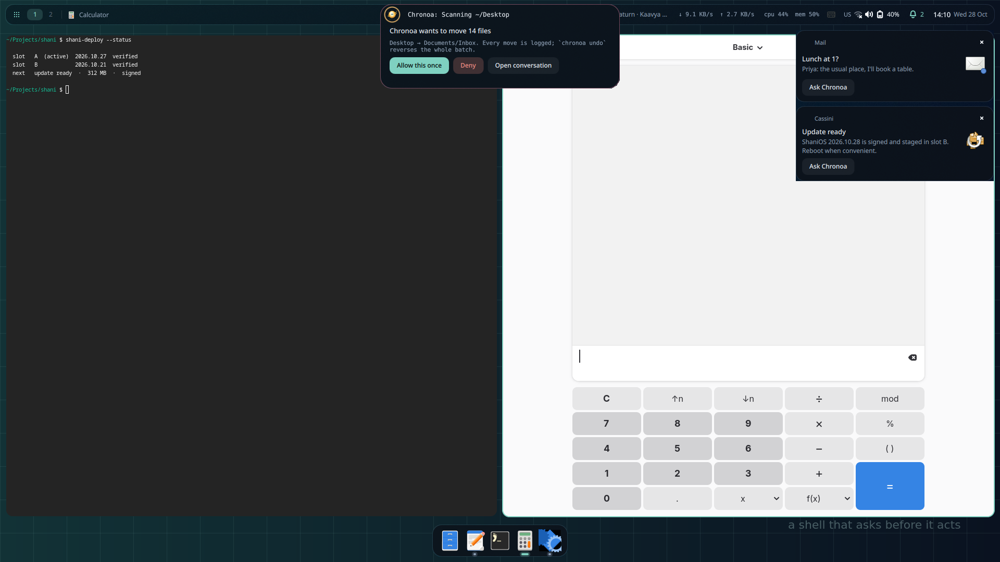

# The ShaniOS desktop — features

**A desktop where everything is a click or a glance away.** Sign in by looking at
the camera. Find anything by typing a few letters. Change any setting by picking
from choices — never by typing values you'd have to know. And when you're not
using it, it costs almost nothing.

Built on the [niri](https://github.com/YaLTeR/niri) scrolling compositor and
[Quickshell](https://quickshell.org). Every feature below ships today and is
covered by an automated test that drives the real shell.

---

## Sign in without typing

- **Face sign-in** — look at an infrared camera, like Windows Hello. Works on the
  sign-in screen and the lock screen. Set up in five guided looks.
- **Fingerprint** — touch the reader to unlock; enrol fingers in Settings.
- **Your password always works too**, and is still asked for changes to the system.
- **Pick who's signing in** — your picture and name are already chosen; no user
  name to type. "Someone else" is one click away.
- **An on-screen keyboard at sign-in, setup and lock**, opening by itself on
  touchscreens. Plus a **Caps Lock warning** and **Show password**.
- **A lock screen you can use** — notifications, now playing, a camera button,
  restart and power off (each asks twice).

## A desktop that stays out of your way

- **Bar, dock and Island** — workspaces, the focused window with its own minimise,
  maximise and close, now playing, status at a glance. The bar and dock **step
  aside for your windows** and come back at the edge.
- **The Island** — the middle of the bar shows what's happening: a recording, a
  call, a timer, a print job — click to act on it.
- **Overview** of every window, an **Alt+Tab** switcher, a **pie menu** at the
  pointer, **hot corners**, **desktop layouts** to try on with one click.
- **Name your workspaces** from the bar. **Rounded screen corners.**
- **A drop shelf** — drop files on the dock to keep them for later, then drag them
  into any app.
- **Trash on the dock** — drop to bin, empty with two clicks.
- **A desktop right-click menu** — wallpaper, widgets, icons, displays, terminal.

## Find anything

- **One launcher for everything** — apps, open windows, files (and words inside
  them), actions like "dark style" or "lock", a **calculator** with unit
  conversion, **emoji**, **clipboard history**, web search.
- **Picks go where you were** — choose an emoji or a clipboard entry and it's typed
  or pasted into the window you came from.
- **Apps' own answers** — GNOME Calculator, Files, Characters and more add their
  results.
- **Lens** — select part of the screen to read its text, scan a QR code, copy,
  search, translate, or ask the assistant about it.

## Quick Settings and notifications

- **Quick Settings** — volume, brightness and ~40 tiles (Wi-Fi, Bluetooth, VPN,
  hotspot, Do Not Disturb, night light, dark style, screen record, screenshot,
  colour picker, keyboard light, compass…). Each tile **appears only where it can
  work**; rearrange them in place.
- **Do Not Disturb for an hour, until your meeting ends, or until tomorrow** — and
  **quiet hours** every night.
- **Notification rules** — no pop-ups from an app, or drop it altogether, from the
  notification itself or Settings.
- **Swipe a notification away**, **snooze it**, reply inline; **clicking it brings
  its app forward**. Unread notifications **survive a restart**.
- **A sound for each notification**, **flash alerts** for the hard of hearing.

## Type however suits you

- **On-screen keyboard** in English, **Marathi** with smart matras, and **any of
  598 keyboard layouts** — including 45 Indian ones.
- **A globe key** to switch languages, the way phone keyboards do.
- **Handwriting** — write on ruled lines with a pen, finger or mouse; scribble over
  a word to rub it out; it's read **on your computer** (English, Hindi, Marathi)
  and typed where you were.
- **Sticky Ctrl and Alt** — tap once for the next key, twice to hold.
- **Voice typing** into any app.
- **Input methods** (fcitx5) with English and Hindi phonetic ready to go.

## Accessible by default

- **Screen reader** support throughout — every control has a name, verified with
  real accessibility tools.
- **Larger text, high contrast, reduce motion, mono audio, magnifier.**
- **Live captions** and **read aloud** for any text.
- **Every keyboard and laptop key works** — screen and keyboard brightness,
  touchpad on/off, airplane mode, display, calculator, search, mail, browser,
  files, settings, lock.

## Screen, camera and media

- **Screenshots** — region, window or screen; on a 3- or 10-second timer; offered
  for annotation right after.
- **Screen recording** — the screen or a region, with **computer sound and your
  microphone on two separate tracks**; make a GIF or a smaller copy in one click.
- **One media card for every player** — choose which to follow when several play;
  tinted from the album art; **synced lyrics** if you want them.
- **Camera** — photos and video, and a **privacy light** whenever anything uses the
  camera, microphone or screen.
- **Screen ruler, colour picker, QR codes** from the clipboard, **file actions**
  (convert a picture, shrink a file to a form's size limit, read the text in it).

## Devices and your phone

- **Bluetooth** pairing with the code shown big and clear; a **low battery warning**
  for headphones, mice and watches right in the bar.
- **Drives** — mount, eject, and unlock encrypted ones from Quick Settings.
- **Printers** added automatically; print jobs shown as they run.
- **Your phone (Shani Link)** — calls on your phone, your landline or the laptop's
  own modem; texts; **one address book**; one call history; a dial pad that finds
  contacts as you type; phone links anywhere open the dial pad; use the phone's
  internet over Bluetooth. Watches and fitness bands too.
- **Calls ring once**, on the Island, wherever they come from.
- **Gaming mice, game controllers, drawing tablets, touchscreens** and **sensors**
  (light, rotation, compass, GPS) are recognised.

## Power that thinks ahead

- **Sleep, then hibernate** on laptops so a flat battery never loses your work — or
  **hybrid sleep** for a copy on disk. Offered only where your computer can.
- **60 Hz on battery** for fast laptop screens, back up on the charger.
- **Battery saver** at 20 %, a **charge limit** to keep the battery healthy.
- **Caffeine** to stay awake (it doesn't survive a reboot by accident).
- **Displays** — arrange, scale, rotate, mirror, set the refresh rate; every change
  is **confirmed or undone in 15 seconds**.

## Make it yours, without hunting

- **Settings you pick, not type** — weather from your own city, suggested computer
  names, ready-made bar buttons, popular web apps, DNS in plain words (fast,
  blocks harmful sites, blocks ads, safe for family).
- **Your own keyboard shortcuts** — press the keys, pick an app or action. A taken
  combination is refused before it can break anything.
- **Wallpapers** — your own, a slideshow, one per screen, or **found online** with
  one search. **Accent colour from your wallpaper.**
- **Light and dark** that follow the time of day.
- **First setup in six short steps**, in six languages, with a screen keyboard and
  accessibility options from the first screen.
- **A friendly tour** of the essentials on first login.

## An assistant that's part of the desktop

- **Chronoa** lives in the middle of the bar: ask from the Island, the launcher, a
  notification, a screen selection or the pie menu.
- **Approve or deny in place** when it wants to act.
- **Ask about a file, a window, an error or a notification** in one click.

## Fast and light

- **Nothing redraws while you're not doing anything** — measured: at most a few
  frames in 15 seconds at rest.
- **Rarely used surfaces are only made when opened**, then dropped.
- **No polling where the system can tell us** — devices, cameras, displays and
  notifications arrive as events.
- **Apps run in their own scope**, so restarting the desktop never closes them.
- Every release is checked for **idle cost, memory, open speed, leaks and startup
  time** by the test suite.

---

## Coming next

Being built now, not yet shipping:

- A **greeting when you plug something in** — a monitor asks "extend, mirror or
  present?", a camera offers to import photos, a tablet asks which screen.
- **Security key (YubiKey) sign-in.**
- **Gaming mouse settings** (DPI, buttons) and a **game controllers** page.
- **The whole desktop by keyboard or game controller** — every control reachable.
- **Unlock with only a mouse** when a keyboard breaks.
