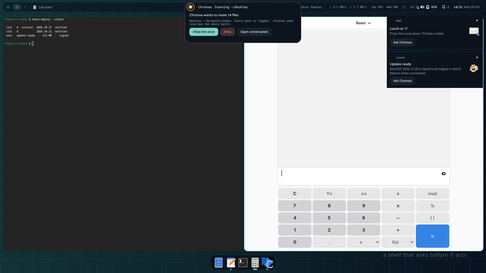
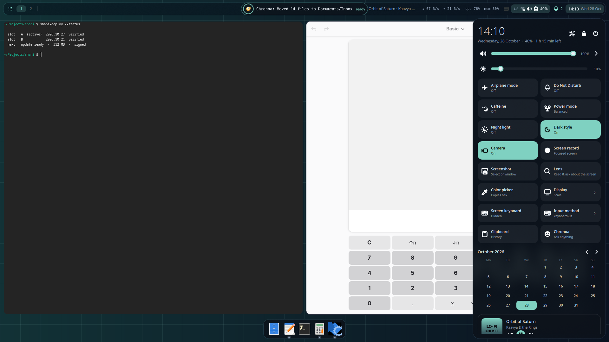

# shani-shell — the ShaniOS AI desktop shell (Quickshell + Chronoa)

An AI desktop on **niri + Quickshell 0.3.2**. Chronoa is not an app in a corner:
its companion lives in the middle of the bar, answers approvals in place, and
can be asked from anywhere — the Island, the launcher, a notification, a
selection of the screen (Lens), or the pie menu.



| Surface | What it does |
|---|---|
| **Island** | Chronoa's mascot (its own art, over `org.shani.Chronoa.Mascot`) in the bar; grows to show the tool step in progress; opens into an **Approve / Deny card** when Chronoa asks; click the line to ask a question; right-click for Lens |
| **Bar** | launcher, niri workspaces, focused window, now playing, ↓/↑ net speed, cpu/mem, recording + mic/camera/**screen-sharing** privacy dots, tray, status cluster with the input method, notifications, clock with an update dot |
| **Sidebar** | Raven-style: power row, volume/brightness, ~20 quick tiles (Wi-Fi, Bluetooth, airplane, hotspot, VPN, DND, caffeine, power mode, night light, dark style, mic, camera kill switch, screen record, screenshot, color picker, Lens, auto-rotate, flashlight, keyboard, clipboard, Chronoa) — each only where it can work — with Wi-Fi/Bluetooth/VPN/audio lists, calendar, media card, notification history grouped by app with inline reply and **Ask Chronoa**, per-app volume mixer, display scale + mirroring, removable drives (mount / eject), ShaniOS update status (shani-deploy) |
| **Dock** | Latte-style: parabolic zoom, launch bounce, window indicators, pins |
| **Launcher** | full screen. Empty: frequent apps, recent files, the app grid with category chips. Typing: one ranked list — apps (with their actions), open **windows**, **actions** (a command palette: dark style, DND, lock, Lens, wifi …), **files** (recent + home search via fd/find), calculator, emoji, clipboard, web — with **Chronoa** on the right, one keystroke away (Ctrl+Enter, about the selected file too). Prefixes `= : c > ?` still work |
| **Lens** | select part of the screen: its text (Tesseract, offline), QR/barcodes (zbar), copy/search/translate — or ask Chronoa, which *sees* it through its `look_at_image` skill |
| **Ring** | a pie menu at the pointer (Mod+X): Chronoa, Lens, screenshot, media, window, workspaces, apps, power; sub-rings on dwell |
| **Alt+Tab** | every window, most recent first, the previous one preselected; releasing Alt switches |
| **Screen keyboard** | the shell's own, typing through niri's virtual-keyboard protocol: hand-made English and **मराठी** (smart matras: क + आ = का), plus **any of xkb's 598 layouts** (45 Indian — Marathi, Hindi, Tamil, Telugu, Bengali, Gujarati, Kannada, Malayalam, Odia, Gurmukhi, Sanskrit …; Cyrillic, Arabic, Greek, Hebrew, Thai …) generated from the system's own xkb data by `bridge/osk-layout.py`, chosen in settings; never steals focus, never fights the input method |
| **Input methods** | fcitx5 (English + Hindi phonetic by default, 179 m17n tables); the active one in the bar (हि), switched from the sidebar |
| **Window menu** | click the focused window's title: close, fullscreen, float, maximize, center, move to a workspace, ask Chronoa about it (no global menus: niri has no appmenu protocol and GTK 4 apps export none) |
| **Focus modes** | Work / Sleep / Personal (after macOS, Android): hold back notifications except allowed apps, warm or keep awake, on a schedule or by hand |
| **Also borrowed** | hot corners (GNOME), battery saver at 20 % (Android), screen time (Digital Wellbeing), the shelf of recent screenshots/recordings/downloads (ChromeOS), Quick Look of the selected file in the launcher (macOS), the phone through KDE Connect |
| **Accessibility** | screen reader (Orca; every shell control has an accessible role and name — verified through AT-SPI), large text (shell + apps), high contrast, reduce motion, mono audio, screen keyboard, voice typing |
| **Look** | light and dark palettes that follow Dark style, accent from the wallpaper (optional), soft shadows, opening motion, Inter with tabular figures, a blurred lock screen with media controls and your avatar, day/night wallpapers |
| **Live Activities** | the Island carries what is in progress when Chronoa is idle: recording, voice typing, the focus timer, screen sharing, a backup, now playing — a click acts on it |
| **Notifications, more** | snooze 1 h, summaries by Chronoa, quiet while presenting or fullscreen (a game also gets the performance profile), screenshots offered for annotation (satty) or Chronoa |
| **Voice typing** | the screen keyboard's mic: record, transcribe with Chronoa's own speech engine in the keyboard's language, type it where the keys would |
| **Search providers** | the launcher asks apps' own search (GNOME SearchProvider2): Calculator, Files, Characters, Settings … |
| **Settings** | a page in the sidebar: wallpaper picker, bar and dock items, blur, reduce motion, night-light temperature, idle timings |
| **Lock / idle** | ext-session-lock + PAM (`/etc/pam.d/shani-lock`); dim → lock → screen off → suspend; `loginctl lock-session`; locks **before** sleep (logind delay inhibitor) |
| **Polkit agent**, **OSD**, **notifications** (DND lets critical through), **greeter** (greetd, same theme, remembers the user) | |



## Layout
```
shani/              Quickshell config (`qs -c shani`)
  shell.qml         root: modules + `ipc call shani <fn>` (incl. `state` as JSON)
  Common/           Theme tokens, Settings (live JSON), Ui state, small widgets
  Services/         one singleton per system: Niri (event stream), Audio, Net,
                    Power, Notifs, Lock, Idle, Polkit, Lens, Recorder, Chronoa, …
  Modules/          Bar, Island, Sidebar (ControlCenter), Dock, Launcher, Lens,
                    Ring, Notifications, Osd, Lock, Polkit, Chronoa, Idle
greeter/            greetd greeter (`qs -c shani-greeter`); Common -> ../shani/Common
bridge/             shani-chronoa-bridge: D-Bus <-> the shell's socket
                    (Chronoa's Agent/Mascot/Windows, logind lock + sleep)
data/               systemd user units, pam.d/shani-lock
dev/                test harness (below), mock Chronoa, fake greetd/MPRIS
docs/shots/         every test's screenshots (written by a test run; not in git)
```
Settings: `~/.config/shani-shell/settings.json` — any subset of the keys in
`shani/Common/Settings.qml`; edits apply live, toggles write back.

## Packaging
`shani-pkgbuilds/shani-shell` (this repo) and `shani-pkgbuilds/shani-desktop-niri`
(the session: niri config with keybinds, greetd + this greeter, portals, the
tools every tile uses). Development: link the checkout over the packaged config:
`ln -s ~/Documents/shani/shani-shell/shani ~/.config/quickshell/shani`

## Settings and Cassini: one place for each thing
The shell's Settings has what a desktop's settings app has; Cassini (the system
manager) has what goes beyond it, and neither repeats the other. The list is in
shani-cassini's AGENTS.md ("Cassini and shani-shell"). The shell opens Cassini on
a page with `shani-cassini --section=<id>` (update badge, firmware, a failing
disk, Settings > About's "More in Cassini"); inside the shell Cassini's Chronoa,
Printers and fingerprint enrolment point back here
(`qs -c shani ipc call shani settingsCategory <id>`).

## Tests — everything is run, not read
```
docker build -t shani-shell-dev -f dev/Containerfile dev
docker run --rm --cap-add SYS_PTRACE -v "$PWD":/work -v ../shani-testbed:/testbed:ro \
    shani-shell-dev sh /work/dev/shell-test.sh                                  # the shell
#   SHELL_TEST_ONLY=idle (-e): just the idle cost   SHELL_TEST_ONLY=a11y: idle + accessibility
docker run --rm -v "$PWD":/work shani-shell-dev sh /work/dev/greeter-test.sh   # greeter
sh dev/polkit-run.sh                                                            # polkit (systemd + logind)
python3 -m pytest tests -q                                                      # bridge: turn filter, logind
```
Three checks guard the whole shell, not one feature:
- **idle-cost** — 30 s with nothing happening: the programs the shell starts
  (strace on its execve calls, hence SYS_PTRACE; budget 12/min, today 2–4), its
  CPU (budget 15 ms/s) and memory. A new always-on poller fails here, by name.
- **a11y-\*** — shani-testbed's AT-SPI client (mounted at /testbed) lints the
  bar, control centre, launcher, every Settings category and Chronoa: every
  control has a name a screen reader can say.
- **i18n-\*** — the shell restarted in Marathi, its catalog loaded and the bar
  read back in Marathi through AT-SPI. `tools/i18n.py check` lists each
  catalog's gaps; strings a catalog lacks can be translated on the machine by
  Chronoa's local model (opt-in: Settings > Date & language).

`shell-test.sh` brings up a nested niri with a system bus and the real daemons
(NetworkManager, UPower, power-profiles-daemon, BlueZ), PipeWire with null
sinks, the bridge and mock Chronoa, then drives each feature for real (wpctl,
notify-send, niri actions, wtype keystrokes, gdbus into the bridge, the
settings file) and asserts on the shell's own `state`.

**Not verifiable nested** (no GPU / no gamma in a nested niri), so checked on
real outputs in shani-testbed: a real screen recording (wf-recorder gets a 0×0
frame nested; the test checks the failure is reported), night light (needs
wlr-gamma-control), auto-rotate (needs an accelerometer).

See `FINDINGS.md` for the measurements and the bugs these tests caught.
